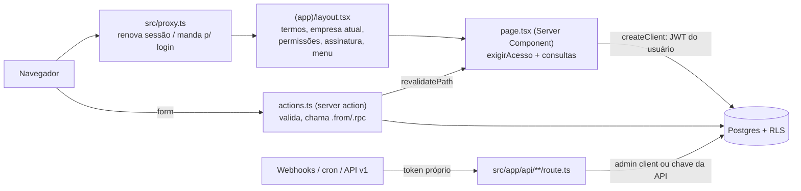

# Arquitetura

Um app Next.js e um banco Supabase (Postgres), sem microsserviços. As **regras de negócio críticas ficam no banco** (triggers, constraints, funções e RLS), e a tela só repete as validações para dar uma mensagem melhor. Se um dia a tela errar, o banco recusa.

## Peças

| Peça | O que é | Onde |
|---|---|---|
| Next.js 16 (App Router) + React 19 + TypeScript | Telas, server actions e rotas de API num só código | `src/app`, `src/components`, `src/lib` |
| Tailwind 4 + `ui.tsx` | Visual Liquid Glass com tokens de `globals.css` | `src/app/globals.css`, `src/components/ui.tsx`, `DESIGN.md` |
| Supabase Postgres (São Paulo, `sa-east-1`) | Dados, regras, RLS por empresa, `pg_cron`, Vault | `supabase/migrations` |
| Supabase Auth | Login (usuário/senha), MFA (TOTP ou código por e-mail), convites | `src/app/auth`, `src/app/login`, `src/lib/mfa.ts` |
| Vercel (região `gru1`) | Hospedagem; 2 rotinas diárias de reserva em `vercel.json` | `vercel.json` |
| Service worker | Abre `/campo` e `/vendedor` sem internet | `public/sw.js` |
| Serviços externos | Asaas (cobrança e assinatura), Focus NFe (notas), Pluggy (Open Finance), Anthropic (leitura de documento e chat do campo por IA), Meta WhatsApp, Web Push, Postmark Inbound, Cloudflare Turnstile | [integracoes.md](integracoes.md) |

## Como uma requisição anda

1. **`src/proxy.ts`** (no Next 16 o antigo `middleware.ts` chama-se `proxy`): se `BALBINA_MANUTENCAO=1`, responde a página de manutenção. Senão, `updateSession` (`src/lib/supabase/proxy.ts`) renova o cookie de sessão. Quem não está logado vai para `/login?voltar=...`, e uma chamada `/api/*` recebe 401. Ficam de fora as rotas públicas (`/login`, `/auth`, `/api/webhooks`, `/api/cron`, `/api/entrada`, `/pedido`, páginas legais) e `/api/v1`, que se autentica pela chave da API.
2. **`src/app/(app)/layout.tsx`** monta o "casco" do sistema logado. Ele confere o aceite dos termos, carrega a empresa atual (`getEmpresaAtual`, cookie `empresa_id`), as permissões (`getPermissoes`) e a situação da assinatura, e desenha a barra lateral só com os módulos que a pessoa pode ver (`GRUPOS` + `podeVerModulo` em `src/lib/modulos.ts`).
3. **`page.tsx`** é um Server Component. A primeira linha é `await exigirAcesso("<modulo>")`, que manda para `/sem-acesso` quem não tem `<modulo>.ver`. Depois ele consulta o banco com `createClient()` (`src/lib/supabase/server.ts`), que leva o JWT do usuário, e por isso **toda leitura passa pelo RLS**.
4. **`actions.ts`** (`"use server"`) recebe o `FormData` do formulário, valida, grava (`.from().insert/update` ou `.rpc()`) e devolve um `EstadoAcao` (`{ erro }` ou `{ ok, versao }`, de `src/lib/acao.ts`). Erros do Postgres passam por `mensagemBanco` para virar texto legível. No fim, `revalidatePath` atualiza a tela.
5. **Rotas de API** (`route.ts`) que chegam sem sessão (webhooks, cron, entrada) conferem um token próprio e usam `createAdminClient()` (`src/lib/supabase/admin.ts`, chave de serviço, passa por cima do RLS). Esse cliente é **só** para isso e para convites. Nunca use em ação de usuário.

## Multiempresa e acesso: três travas em camadas

1. **Sessão + 2º fator.** Sem o MFA concluído, o banco não devolve dado nenhum (`mfa_pendente`, `app.mfa_em_dia`). `exigirSegundoFator` em `src/lib/mfa.ts` manda para `/auth/mfa`. Operacionais podem ficar sem MFA; master, financeiro e administrativo nunca.
2. **Empresa.** `app.minhas_empresas()` lista as empresas de que o usuário é membro. Toda tabela com `empresa_id` tem a policy `membros` filtrando por ela. O app ainda filtra `.eq("empresa_id", atual.id)`, porque o usuário pode estar em várias empresas.
3. **Permissão e plano.** `app.pode(empresa, 'modulo.acao')` junta o perfil/cargo do usuário com o plano da empresa (Basic, Vendas, Fiscal, Gestão; tabela `niveis_plano`). Policies restritivas de escrita usam `app.pode(...)`. No app, a mesma regra está em `src/lib/permissoes-regras.ts` (`temPermissao`, `planoInclui`) e chega à tela por `getPermissoes()` → `minhas_permissoes`. Ação que chama serviço externo **antes** de gravar (Asaas, Focus, Pluggy) precisa checar `pode(...)` ou `foraDoPlano(...)` primeiro, porque o RLS só barraria depois da chamada.

A assinatura do próprio Balbina (o SaaS) também é conferida no banco. `app.minhas_empresas()` e `app.pode()` só valem com `app.assinatura_libera(...)` / `app.empresa_liberada(...)` verdadeiros, então uma empresa com a assinatura bloqueada deixa de aparecer para os usuários até o pagamento (`/assinatura`, `src/lib/assinatura.ts`).

## Dados que precisam de cuidado

- **Dinheiro** em centavos inteiros (`*_cents bigint`). Formatação em `src/lib/formato.ts`.
- **Datas "de hoje"** no fuso da empresa (`empresas.fuso`, padrão `America/Manaus`): `app.hoje(empresa)` no banco e `hojeISO(fuso)` no app. Nunca use `current_date` nem `new Date()` cru para decidir vencimento ou dia de lançamento.
- **Pescado**: o estoque é em **kg** (com casas decimais), um saldo por classe no produto base "(estoque)". "Peixe <classe> (kg)" e "Caixa 20 kg" são só formas de vender (`produtos.fator_kg`, `src/lib/pescado.ts`). Alevinos e juvenis são o tipo `alevino`, em unidades. Regras do peixe em [`docs/piscicultura.md`](../piscicultura.md).
- **Mais de 1.000 linhas**: o PostgREST corta em 1.000 sem avisar. Soma ou relatório que pode passar disso lê com `lerTodas` (`src/lib/supabase/todas.ts`), sempre com uma ordem estável.

## Fora da tela: rotinas e entradas automáticas

| O quê | Quem dispara | Onde |
|---|---|---|
| Automações (lembretes de lançamento do viveiro, pedidos fixos, cobrança por WhatsApp, notas recebidas, pacote do contador, resumo) | `pg_cron` `balbina-automacoes` a cada 15 min → `GET /api/cron/automacoes` | `src/app/api/cron/automacoes/route.ts`, `docs/automacoes.md` |
| Recorrências (títulos futuros) | `pg_cron` `balbina-recorrencias` diário | `app.gerar_recorrencias_todas` |
| Entrega dos webhooks da API pública | `pg_cron` `balbina-webhooks-api` a cada 5 min; reserva diária na Vercel e no Actions | `/api/cron/webhooks`, `src/lib/api/webhooks.ts` |
| Extrato do Open Finance | Vercel cron diário + webhook da Pluggy | `/api/cron/open-finance`, `/api/webhooks/pluggy`, `src/lib/open-finance.ts` |
| Pagamento confirmado (Asaas), nota autorizada (Focus) | Webhook do provedor | `/api/webhooks/*` |
| Documento por e-mail ou WhatsApp | Postmark Inbound, Meta | `/api/entrada/*` |

O `pg_cron` chama o app usando a URL e o segredo guardados no **Vault** do Supabase (`balbina_url`, `cron_secret`). Eles não vão no backup e precisam ser recadastrados numa restauração (`docs/backup.md`).

## Apps de celular que funcionam sem internet

- **`/campo`**: o app da beira do viveiro, com cinco abas (chat, viveiros, ração, biometria, envios; ver [`docs/piscicultura.md`](../piscicultura.md)). Tudo o que o tratador lança entra primeiro numa fila no `localStorage` (`src/lib/campo/fila.ts`, `src/components/campo/fila-cliente.ts`) e sai para a rota certa quando há sinal: `/api/apontamentos` (ração do turno, mortes, água), `/api/lancar-insumos`, `/api/biometrias`, `/api/abrir-lote` e `/api/lotes/:id/fechar`. Cada envio leva um `client_id` único, e o banco ignora o repetido, então reenviar não duplica. O chat (`/api/chat/manejo`) precisa de sinal e só propõe: o lançamento sai do cartão que o tratador confirma, pela mesma fila. Regras puras e testes em `src/lib/campo/`; servidor em `src/lib/campo/servidor.ts`.
- **`/vendedor`**: pedido em campo com o catálogo e a tabela de preço do cliente (`src/components/vendas/vendedor.tsx` → `/api/pedidos`).
- `public/sw.js` guarda essas duas telas e os arquivos estáticos. Ao mudar o que elas usam, suba a versão do `CACHE`.

## App nativo para iOS e Android (pasta `mobile/`)

Canal a mais, ao lado do site (que continua igual no celular). React Native com Expo e Expo Router; detalhes e passos das lojas em `docs/app-celular.md`.

- **Mesmas regras:** o app usa o mesmo Supabase com o login do próprio usuário (supabase-js, sessão no cofre do aparelho em `mobile/src/lib/cofre.ts`). RLS, permissões por cargo e plano e as funções do banco valem igual. Regras puras de `src/lib` entram no app pelo atalho `@regras/` (`mobile/metro.config.js`); só arquivo sem React, sem `server-only` e sem `next/*`.
- **Login e 2º fator:** o app não tem cookie. `POST /api/app/login` (trava de 5 erros, captcha, usuário sem e-mail) devolve a sessão em JSON; `POST /api/app/mfa` faz o código por e-mail, confirma o app autenticador e o "confiar neste aparelho" com as mesmas funções de `src/lib/mfa.ts`. As rotas `/api/app/*` passam pelo proxy sem sessão e conferem o token do cabeçalho (`src/lib/app-celular/sessao.ts`). O captcha do app é a página `/app-captcha` numa WebView.
- **Lançamento do viveiro (aba Apontar):** `POST /api/app/campo` devolve os viveiros, rações, checklist, medicamentos e sugestões (o mesmo `dadosCampo` da tela `/campo`, em `src/lib/apontamento-campo-servidor.ts`), que o app guarda para usar sem sinal. A fila fica no aparelho (`mobile/src/lib/campo/`) e vai para `POST /api/app/apontamentos`, que chama o mesmo `gravarApontamentoCampo` do `/api/apontamentos`. Antes de entrar na fila, o app roda o mesmo `validarApontamentoCampo` do servidor. As rotas de dados conferem a empresa pelo RLS e a assinatura (`empresaDoApp`).
- **Vendas (aba Vender):** `POST /api/app/vendas` devolve o catálogo do vendedor (`carregarCatalogo`, o mesmo do `/vendedor`) e os últimos pedidos do usuário; o pedido vai da fila do aparelho (`mobile/src/lib/vendas/`) para `POST /api/app/pedidos`, que chama o mesmo `gravarPedidoCampo` (`src/lib/pedido-campo-servidor.ts`) do `/api/pedidos`. As duas exigem `vendas.lancar` (`permissoesDoApp`). O preço no app é estimativa com `precoVigente`; o banco recalcula.
- **PDV de balcão (aba Vender > Balcão):** `POST /api/app/pdv` devolve os pontos de venda, o catálogo com o estoque do ponto escolhido, as contas e o vendido no dia; `POST /api/app/pdv/vender` grava com `gravarVendaBalcao` (`src/lib/pdv-servidor.ts`), a mesma do `venderNoBalcao` do site. O corpo passa por `validarVendaBalcao` (`src/lib/pdv.ts`) no app e no servidor; o preço nunca vem do caixa. As duas exigem `pdv.operar`. Sem fila offline: o `client_id` só torna o reenvio inofensivo.
- **Painel do dia (tela Início):** `POST /api/app/painel` devolve a lista de viveiros (com `apontado` = último lançamento é hoje), pedidos faturados com entrega prevista para hoje (só com `vendas.ver`) e alertas dos lotes da view `alertas` (água, mortalidade, crescimento, biometria, lançamento, carência, despesca, sanidade, estoque — sem financeiros). O hook `usePainel` recarrega ao abrir o app e no pull-to-refresh.
- **Visual:** as cores vêm de `src/app/globals.css` por `npm run tokens:celular` (gera `mobile/src/tema/tokens.ts`; `-- --conferir` só confere). Primitivos em `mobile/src/componentes/ui.tsx`, espelho do `ui.tsx` do site.
- **Verificar:** dentro de `mobile/`: `npm run lint`, `npm run typecheck`, `npm test`. O lint e o tsconfig da raiz ignoram `mobile/`.

## Diferenças do plano original

O [`architecture.md`](../legado/finavi/replica/architecture.md) do FINAVI, de 2026-10-26, previa algumas peças que não foram usadas:

| Plano | Hoje |
|---|---|
| Drizzle ORM | Não há ORM: `supabase-js` (`.from`/`.rpc`) e SQL puro nas migrations. |
| shadcn/ui, TanStack Table, Recharts | Primitivos próprios em `ui.tsx` e gráficos SVG em `components/graficos.tsx`. |
| IndexedDB/Dexie no app de campo | `localStorage` com fila e `client_id` idempotente. |
| Inngest para jobs | `pg_cron` do Supabase + cron da Vercel. |
| Supabase Auth por e-mail/magic link | Usuário e senha criados pelo master (sem e-mail obrigatório) + MFA. |
| Resend | Códigos de e-mail pelo Supabase Auth; entrada de documentos pelo Postmark. |
| Preview por PR na Vercel | Desligado (`ignoreCommand`, `scripts/vercel-ignorar.sh`): só o branch `Teste-Desevolvimento` vira preview, o site de teste com Supabase próprio (`docs/site-de-teste.md`). |
