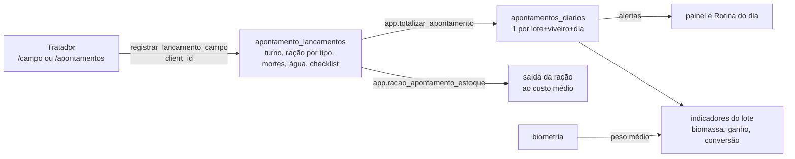
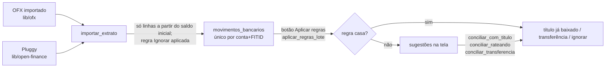

# Módulos

Cada módulo do menu está em `GRUPOS` (`src/lib/modulos.ts`). Aqui está, por área, o que o módulo faz, por onde o dado entra e quais funções do banco seguram a regra. Para a lista completa de arquivos e funções de cada área, veja [`docs/mapa-codigo/codigo-por-dominio.md`](../mapa-codigo/codigo-por-dominio.md).

Os caminhos de tela ficam abreviados: `(app)/x` quer dizer `src/app/(app)/x/`. `lib/x` quer dizer `src/lib/x.ts`.

---

## Produção

O domínio do peixe (vocabulário, ciclo do lote, tabela de arraçoamento, faixas da água) está em [`docs/piscicultura.md`](../piscicultura.md).

**Viveiros** (`(app)/piscicultura`): setores (com licença ambiental) e viveiros com sistema (escavado, barragem, tanque-rede, alvenaria, lona), área, volume, profundidade, aeração e finalidade (alevinagem, recria, engorda). Cada um ganha um centro de custo (`app.cc_automatico`).

**Lotes** (`(app)/lotes`): povoamento (`povoar_lote`: espécie, quantidade, peso inicial, custo dos alevinos e peso de abate), espécies e curvas de crescimento (`(app)/lotes/especies`), biometria (`registrar_biometria`), transferência entre viveiros (`transferir_lote`), encerramento e reabertura. Um viveiro não recebe dois lotes ao mesmo tempo (exclusion constraint em `lote_alocacoes`). Entre duas biometrias o peso vem da curva (`app.peso_estimado`).

**Apontamento diário** (`(app)/apontamentos`, `/campo`, `/api/apontamentos`): o trato do viveiro, o coração da produção.

- Um lançamento por viveiro, dia e turno; lançar de novo no mesmo turno pede confirmação (`p_forcar`). A lixeira e a restauração revertem o estoque pelos triggers (`apontamentos_lixeira`, `lib/apontamento-excluir`). Gerente e master editam qualquer dia; o tratador, só o de hoje.
- O checklist do viveiro é obrigatório. Os itens padrão nascem com a empresa (`app.checklist_padrao`).
- A ração sugerida sai da tabela de arraçoamento pela biomassa estimada (`racao_sugerida`), e oxigênio abaixo de 3 mg/L suspende a sugestão. A amônia tóxica é calculada pela total, pH e temperatura (`app.amonia_toxica`, `lib/agua`).
- Ajudas no lançamento (todas são só sugestão; a pessoa confere): pré-preenchimento pelos dias anteriores (`lib/sugestao-apontamento`), voz (`lib/fala-apontamento`), contagem de mortes por foto com IA (`foto-mortes-action.ts`) e, no `/campo`, o chat que transforma uma frase num cartão para confirmar (`lib/campo/propostas`, `/api/chat/manejo`).

**Despescas** (`(app)/despescas`): despesca parcial ou total (`registrar_despesca`), com os kg por classe de tamanho que entram no estoque. A total esvazia o viveiro e, se for o último do lote, encerra o lote. A carência de medicamento trava a despesca (`app.carencia_ate`). Só a última despesca do lote pode ser desfeita, e só enquanto o peixe não foi vendido (`desfazer_despesca`).

**Sanidade** (`(app)/sanidade`, `(app)/medicamentos`): banhos e medicamentos na ração ou na água com **carência** (view `medicacoes`), calagem, adubação e análises. Os insumos aplicados no `/campo` entram por `/api/lancar-insumos` (`registrar_insumo_viveiro`).

**Indicadores zootécnicos** (`(app)/relatorios/indicadores`, `(app)/lotes/[id]`, `lib/zootecnico`, `lib/crescimento`): sobrevivência, biomassa, ganho por dia, conversão alimentar e peso por semana de cultivo contra a curva da espécie (views `indicadores_lote_dia` e `indicadores_lote_semana`). Não há tabela derivada: tudo sai do lançamento, da biometria e da despesca.

Testes: `20_producao_titulos.sql`, `99_apontamento_campo.sql`, `99_campo_insumos.sql`, `99_biometria_crescimento.sql`, `99_apagar_apontamentos.sql`, `99_checklist_racao_apontamento.sql`, `99_transferencia_lotes.sql`, `99_causas_mortalidade.sql`, `99_medicamentos.sql`; E2E `producao-vendas`, `apontamento-lixeira`, `tela-celular`. Regras puras do `/campo` em `src/lib/campo/*.test.ts`.

---

## Estoque

**Estoque de pescado** (`(app)/estoque`): um saldo em **kg** por classe (Inteiro, Pequeno, Médio, Grande, Extra, Descarte), guardado no produto base "(estoque)" de cada classe (view `estoque_peixe`). "Peixe <classe> (kg)" e "Caixa 20 kg" são só formas de vender (`produtos.fator_kg`, `lib/pescado`, `app.produtos_venda_peixe`). A despesca dá a entrada; o ajuste de inventário usa `ajustar_estoque_peixe`. As classes ficam em Piscicultura > Classes.

**Estoque de ração** (`(app)/racao`; `lib/racao-estoque`): a piscicultura compra ração pronta. A ficha técnica fica no produto tipo `racao` (`fabricante`, `proteina_pct`, `granulometria`, `saco_kg`, `fase_recomendada`). Cada compra é uma entrada numerada R-1, R-2... (`racao_entradas`, `registrar_entrada_racao`) com lote de fabricação e validade; o número vem de `empresas.racao_ultimo_numero` e não volta depois de excluir (`excluir_entrada_racao`, só a entrada intocada). Lote, fabricação e validade só mudam enquanto nada saiu da entrada (depois, só preencher o que faltava).

Toda movimentação de ração aponta para uma entrada (`movimentos_estoque.entrada_id`; o trigger `app.racao_movimento_conferir` recusa movimento de ração sem entrada e `app.racao_saldo_conferir` recusa saldo de entrada negativo). O saldo da entrada é explícito (`app.saldo_entrada`, view `racao_saldos` com `ordem_consumo`, `dias_para_vencer`, `vencida`, `custo_kg_cents`).

- **Baixa** (`app.baixar_racao`): sob a trava do estoque da empresa (`app.travar_estoque`), percorre as entradas pelo FEFO (validade mais próxima; empate: chegou antes; depois número), pula as vencidas na data da saída e grava uma linha por entrada usada, com o custo da própria entrada e o mesmo `baixa_id`. Falta de saldo dentro da validade é erro (com os kg vencidos na mensagem). Usada pelo trato (`app.racao_apontamento_estoque`, que também grava o custo efetivo em `apontamento_racoes.custo_unit_cents`), por `movimentar_estoque`/`registrar_saida` (`app.movimentar_racao`) e pelo ajuste de saldo do produto.
- **Origem** (`movimentos_estoque.origem_lancamento`): web, campo, offline (fila do celular), android, ajuste, importacao, conciliacao, sistema.
- **Custo do lote**: o rateio mensal (`calcular_custos_mes`) lê `custo_unit_cents` dos `consumo_lote`, que agora é o custo da entrada usada; uma compra mais cara depois não muda o custo já lançado.
- **Estorno** (`estornar_baixa_racao`, tabela `racao_estornos`): motivo obrigatório; a ração volta às mesmas entradas com o mesmo custo e lote, a saída original fica (view `racao_movimentos.estornada`). O trato se corrige pelo apontamento, não pelo estorno.
- **Ajuste de uma entrada** (`ajustar_entrada_racao`, tabela `racao_ajustes`): tipo (contagem, perda, avaria, vencimento, correção, outro), motivo, kg antes e depois. É o único jeito de tirar ração vencida.
- Movimento de ração lançado não se apaga direto (`app.racao_movimento_sem_apagar`); só a função que o criou, o apontamento e o zerar do sistema.

**Fábrica de ração (desativada)**: a fábrica herdada da granja saiu em `20261111000002_remover_fabrica_racao.sql`. `salvar_formula` e `produzir_racao` só devolvem a mensagem de desativada; as tabelas `formulas_racao`, `formula_itens` e `ordens_producao_racao` ficam só para leitura (histórico e backup), e o tipo `insumo_racao` virou `outro` (planilha antiga com esse tipo também entra como `outro`). A compra sugerida (`lib/abastecimento`) cobre só a ração comprada.

**Pontos de venda** (`(app)/pontos-de-venda`, `lib/pontos`): cada ponto tem depósito de pescado, caixa e centro de custo próprios (`criar_ponto_venda`). O peixe vai por transferência com frete e perda (`transferir_peixe`, `receber_transferencia_peixe`) ou por venda entre empresas do mesmo dono. Detalhes em [`docs/pontos-de-venda.md`](../pontos-de-venda.md).

Testes: `50_estoque_vendas.sql`, `99_movimentar_estoque.sql`, `99_pontos_venda.sql`, `99_produtos_para_venda.sql`, `99_racao_entradas.sql`, `99_racao_baixa.sql`.

---

## Comercial

**Vendas** (`(app)/vendas`, `lib/vendas`, `components/vendas/*`): pedido → faturar (`faturar_pedido`: tira o peixe do ponto do pedido, baixa as embalagens e cria a conta a receber no centro de custo do ponto) → entregar → receber. Faturamento e entrega podem ser desfeitos enquanto não houver recebimento (`99_desfazer_venda.sql`). Há também pedidos fixos, que geram os pedidos de amanhã pela automação (`gerar_pedidos_fixos`).

**PDV** (`(app)/vendas/pdv`, `components/vendas/pdv.tsx`): venda de balcão por seções (peixe por kg da balança, até 3 casas, e caixas de 20 kg), troco e caixa do dia (`caixa_pdv`). Permissão `pdv.operar`. O estoque de cada classe é um só para o kg e a caixa: o que entra no carrinho já sai do disponível de todas as formas da mesma classe e não deixa passar do que há (`lib/estoque-carrinho.ts`, usado também na nova venda e no vendedor); tirar do carrinho devolve. A baixa definitiva continua no banco ao concluir a venda (`venda_balcao`), que recusa se outro caixa vendeu antes.

**App do vendedor** (`/vendedor`, `/api/pedidos`, `lib/pedido-campo`): pedido no celular, com catálogo e a tabela do cliente, que funciona sem sinal.

**Link de pedido** (`/pedido/[token]`): o cliente faz o pedido sem login (`app.cliente_do_portal`).

**Produtos e tabelas de preço** (`(app)/produtos`, `(app)/insumos`, `(app)/tabelas-de-preco`): `produtos.para_venda` separa o que é vendido do que é consumido. Só produto de venda tem preço (`app.exige_produto_de_venda`). Ativar e desativar em massa (`ativarProdutosEmLote`): desativar só oculta das vendas e lançamentos, sem apagar; o produto que guarda o estoque da classe do peixe (`base_estoque`) fica sempre ativo. O preço é por produto e cliente com vigência, sem sobreposição.

**Notas fiscais** (`(app)/notas`): ver [Fiscal](#fiscal).

Testes: `97_pdv.sql`, `98_tabelas_preco.sql`, `99_venda_entre_empresas.sql`, `99_desfazer_venda.sql`; E2E `producao-vendas`, `vendas-prazo`, `vendas-pontos`, `vendedor`.

---

## Financeiro

**Contas a pagar e a receber** (`(app)/contas-a-pagar`, `(app)/contas-a-receber`, código comum em `(app)/_titulos`, `lib/titulos`): os dois são a mesma tabela `agendamentos` (view `titulos`), diferenciada pelo sentido. Parcelas, recorrências (`gerar_recorrencias`, renovadas todo dia pelo `pg_cron`), baixas parciais e em lote (`baixar_titulos`), rateio por categoria e centro de custo (`ratear_titulo`, `lib/rateio`, `components/rateio.tsx`), que vale também com o título já pago. Documentos recebidos por foto, e-mail ou WhatsApp viram proposta de título (`/contas-a-pagar/documentos`). O pagamento de boleto pelo Asaas fica em `/contas-a-pagar/pagamentos` e está desligado por padrão.

**Contas e saldos** (`(app)/contas`): contas bancárias, caixa e transferências entre contas (`saldos_contas`).

**Cartões de crédito** (`(app)/cartoes`): compras parceladas e faturas (`faturas_cartao`, `app.fechamento_da_fatura`).

**Conciliação** (`(app)/conciliacao`):

O saldo da conta (`saldos_contas`) só soma pagamentos e transferências, então só muda quando um lançamento do extrato é lançado/conciliado. Por isso `importar_extrato` (OFX e Open Finance) não lança nada sozinho: aplica só a regra "Ignorar", que não cria pagamento; as regras que lançam rodam no botão "Aplicar regras". Linhas com data antes do saldo inicial da conta (`contas_financeiras.saldo_inicial_data`) não entram (o retorno conta em `antes_do_saldo`), e o painel, os palpites e as regras também não olham para lançamentos antigos que já estejam no extrato.

As regras rodam em partes de cerca de 3 s para não estourar o tempo do banco (8 s). `desconciliar` e `soltar_conciliacao` desfazem uma conciliação. Apagar um movimento do extrato pede master + MFA.

"Novo pagamento" na conciliação (`conciliacao/campos-novo.tsx`) chama `conciliar_com_estoque`: concilia como `conciliar_rateando` e, na mesma transação, pode lançar a entrada do produto comprado no estoque (`movimentar_estoque`, custo = valor pago). O fornecedor guarda o produto em `contatos.produto_estoque_id`, e a próxima conciliação dele já abre a parte do estoque. Fornecedor/cliente sem cadastro: o nome sai da descrição do extrato (`lib/contraparte`) e vira sugestão de cadastro rápido (`SelecaoComNovo` com `nomeSugerido`).

Arquivo lido por engano: `cancelar_importacao` (quem tem `conciliacao.editar`, motivo no Histórico, sem MFA) tira do extrato as linhas daquele arquivo ainda para conciliar e marca a importação como cancelada (lista "Arquivos importados" na conciliação). O que já foi conciliado ou ignorado fica; ler o OFX de novo traz de volta o que saiu. Open Finance não se cancela.

Já lançado: `app.ja_lancados` acha pagamento (baixa) ou transferência da mesma conta, mesmo valor, até 5 dias, sem extrato ligado. A tela mostra a aba "Já lançado" (`conciliar_com_existente`), e regras e "lançar como nas últimas vezes" não criam título para esses. A conciliação marca `conciliacoes.ja_existia`, e desconciliar mantém o que já existia.

**Fluxo de caixa** (`(app)/fluxo-de-caixa`, `lib/fluxo`): o que está previsto em aberto, por semana, com saldo acumulado (`fluxo_previsto`).

**Cobranças** e **régua de cobrança**: ver [Integrações > Asaas](integracoes.md#asaas).

**Fechamento do mês**: `fechar_mes` e `reabrir_mes` (permissão `financeiro.fechar`). Mês fechado bloqueia mudanças.

**Categorias e centros de custo** (`(app)/categorias`, `(app)/centros-de-custo`): o plano de categorias em árvore na ordem do DRE (`aplicar_plano_categorias`, [`docs/plano-de-categorias.md`](../plano-de-categorias.md)). Os botões **Categorias padrão** e **Centros padrão** (`restaurar_plano_categorias`, `restaurar_centros_custo`, plano dos centros em `app.plano_centros_custo()`) deixam só os padrão: o que não é do plano é apagado, ou desativado quando algo aponta para ele (`app.registro_em_uso`). Centros de setor, viveiro e lote nunca saem. Cada categoria de custo operacional diz em que **componente do custo do kg** entra (`COMPONENTES_CUSTO` em `lib/titulos`). A ordem é arrastável (dnd-kit).

Testes: `20_producao_titulos.sql`, `30_financeiro.sql`, `40_conciliacao.sql`, `95_open_finance_conciliacao.sql`, `99_rateio_conciliacao.sql`, `99_desconciliar.sql`, `99_cancelar_importacao.sql`, `99_regras_em_partes.sql`, `99_plano_categorias.sql`; E2E `financeiro`.

---

## Gestão

**Custo do kg** (`(app)/custo-do-kg`): `calcular_custos_mes(empresa, mes)` refaz `custos_lote_mensal`. A ração entra pelo **consumo real** (saída do estoque para o lote ao custo médio). Os outros gastos (alevinos, sanidade, mão de obra, energia, embalagem e outros) entram pela competência das categorias com componente de custo, rateados para o lote pelo centro de custo (lote, viveiro, setor ou geral, proporcional à biomassa de cada dia em kg·dia, para o berçário com muitos peixes pequenos não levar a maior parte). A view `custo_kg_lote` divide pelos kg produzidos no mês (biomassa do fim − biomassa do início + kg despescados), e a conversão alimentar é a ração sobre esses mesmos kg.

**Planejamento** (`(app)/planejamento`, `lib/planejamento`): simula os ciclos dos viveiros (povoamento, curva de crescimento até o peso de abate, despesca, vazio sanitário entre lotes), a receita por kg, os custos e a viabilidade. O motor é puro e testado em `planejamento.test.ts`.

**Previsões e alertas** (`(app)/previsoes`, `lib/previsao`): contas sem IA sobre o que já foi lançado (produção esperada pela curva, estoque de ração, caixa). Viram sugestão com o motivo.

**Relatórios** (`(app)/relatorios`, `lib/relatorios-catalogo`): a central com DRE (competência e caixa), aging, orçamento × realizado, análise do período (`lib/analise-periodo`), apresentação em PDF/PPTX (`lib/apresentacao*`), vendas, indicadores e o pacote do contador (`lib/pacote-contador`, um .zip mensal). Cada relatório exige a permissão do seu assunto.

**LCDPR** (`lib/lcdpr`): o Livro Caixa Digital do Produtor Rural no leiaute da Receita.

---

## Configurações, usuários e entrada no sistema

- **Login** (`src/app/login`, `src/app/auth/*`): usuário e senha, captcha Turnstile, bloqueio após 5 erros em 15 min (`lib/login-bloqueio`) e MFA por app ou por código no e-mail. Dispositivo confiável por 14 dias. Usuários sem e-mail são criados pelo master (`lib/login-local`).
- **Onboarding** (`src/app/onboarding`) cria a primeira empresa. O **assistente de início** (`lib/assistente`, `/primeiros-passos`) guia os primeiros cadastros. Os **tutoriais** por tela usam Driver.js (`lib/tutoriais`, [`docs/tutoriais.md`](../tutoriais.md)).
- **Usuários e cargos** (`(app)/configuracoes/usuarios`): convites, cargos (tratador, gerente da piscicultura, fabricante de ração, manutenção, vendedor, caixa, administrativo, financeiro e os criados pelo master) e permissões por pessoa. Telas em `components/permissoes-*.tsx`.
- **Importação** (`(app)/configuracoes/importar`, `lib/importacao*`): NIBO (API ou planilha), LC e planilha modelo. Todas viram o mesmo pacote para `importar_pacote`.
- **API e automações** (`/configuracoes/api`, `/configuracoes/automacoes`): ver [integracoes.md](integracoes.md).
- **Zerar financeiro / zerar sistema**: master + MFA + nome da empresa (e o texto `ZERAR TUDO`). Apagam os movimentos e mantêm os cadastros. Há backup antes (`/backup`).
- **Histórico** (`(app)/historico`): o `audit_log` com filtros.
- **Painel** (`(app)/painel`, `lib/painel`) e **Rotina do dia** (`lib/pendencias`): KPIs, alertas e o que falta lançar hoje, por pessoa.
- **Assinatura** (`src/app/assinatura`, `lib/assinatura`): plano do Balbina pago pelo Asaas do fornecedor (ver [integracoes.md](integracoes.md#asaas)).
